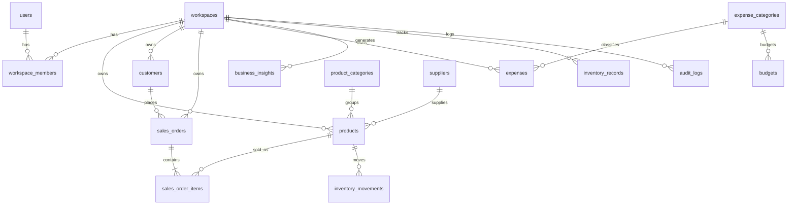

# BizInsight – Database Architecture & Entity Relationship (ER) Model

BizInsight relies exclusively on **MySQL 8.0** with strict workspace data isolation, UTC timestamps, `DECIMAL(12, 2)` for currency values, foreign keys, and indexes.

---

## 1. Entity Relationship (ER) Diagram

---

## 2. Table Specifications

### `workspaces`
| Column | Type | Constraints | Description |
|---|---|---|---|
| `id` | VARCHAR(36) | PK, UUID | Workspace unique ID |
| `name` | VARCHAR(120) | NOT NULL | Business entity display name |
| `slug` | VARCHAR(120) | NOT NULL, UNIQUE | URL-safe slug |
| `currency` | VARCHAR(3) | DEFAULT 'USD' | ISO-4217 Currency Code |
| `created_at` | DATETIME | NOT NULL, UTC | Creation timestamp |

### `workspace_members`
| Column | Type | Constraints | Description |
|---|---|---|---|
| `id` | VARCHAR(36) | PK, UUID | Membership ID |
| `workspace_id` | VARCHAR(36) | FK -> workspaces.id | Owning workspace |
| `user_id` | VARCHAR(36) | NOT NULL, INDEX | Supabase identity `sub` |
| `role` | ENUM | 'owner', 'admin', 'manager', 'analyst', 'viewer' | RBAC role |

### `sales_orders`
| Column | Type | Constraints | Description |
|---|---|---|---|
| `id` | VARCHAR(36) | PK, UUID | Order transaction ID |
| `workspace_id` | VARCHAR(36) | FK -> workspaces.id | Workspace scope |
| `customer_id` | VARCHAR(36) | FK -> customers.id | Ordering customer |
| `order_number` | VARCHAR(64) | NOT NULL | Human-readable order code |
| `status` | ENUM | 'completed', 'cancelled', 'refunded', 'pending' | Lifecycle state |
| `discount_total`| DECIMAL(12, 2)| DEFAULT 0.00 | Total discount applied |
| `tax_total` | DECIMAL(12, 2)| DEFAULT 0.00 | Total tax component |
| `refund_total` | DECIMAL(12, 2)| DEFAULT 0.00 | Total refunded amount |
| `ordered_at` | DATETIME | NOT NULL, INDEX | Order placement timestamp |

### `sales_order_items`
| Column | Type | Constraints | Description |
|---|---|---|---|
| `id` | VARCHAR(36) | PK, UUID | Item line ID |
| `order_id` | VARCHAR(36) | FK -> sales_orders.id | Parent sales order |
| `product_id` | VARCHAR(36) | FK -> products.id | Sold product SKU |
| `quantity` | INT | NOT NULL, > 0 | Number of units purchased |
| `unit_price` | DECIMAL(12, 2)| NOT NULL | Selling price at checkout |
| `unit_cost` | DECIMAL(12, 2)| NOT NULL | Cost snapshot at sale time (COGS anchor) |
| `line_discount`| DECIMAL(12, 2)| DEFAULT 0.00 | Line-specific discount |

### `inventory_records` & `inventory_movements`
- `inventory_records.quantity_on_hand` is the fast-lookup current stock balance.
- `inventory_movements` logs every delta: `quantity_delta` (+ for receipt/return, − for sales/damage).
- **Integrity Assertion:** $\text{quantity\_on\_hand} = \sum (\text{quantity\_delta})$ across all historical movements for each product.
